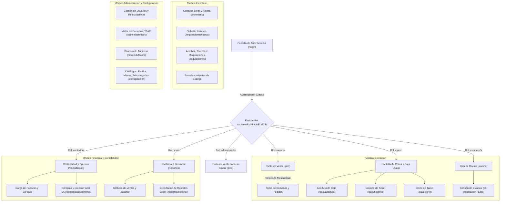
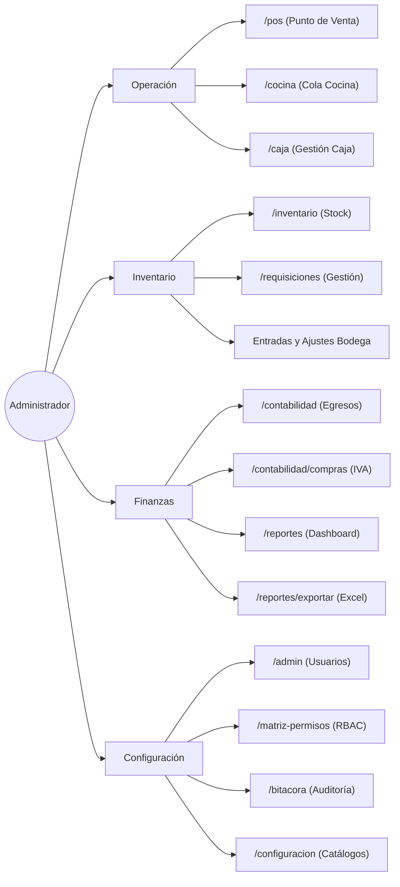
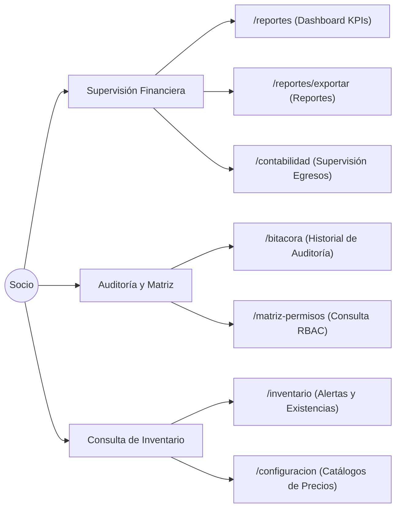
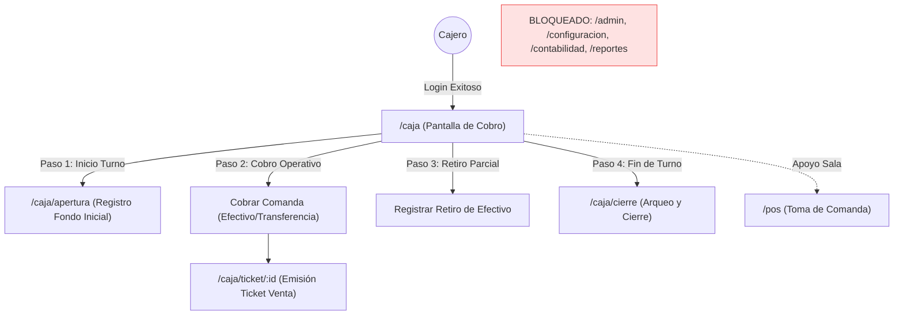
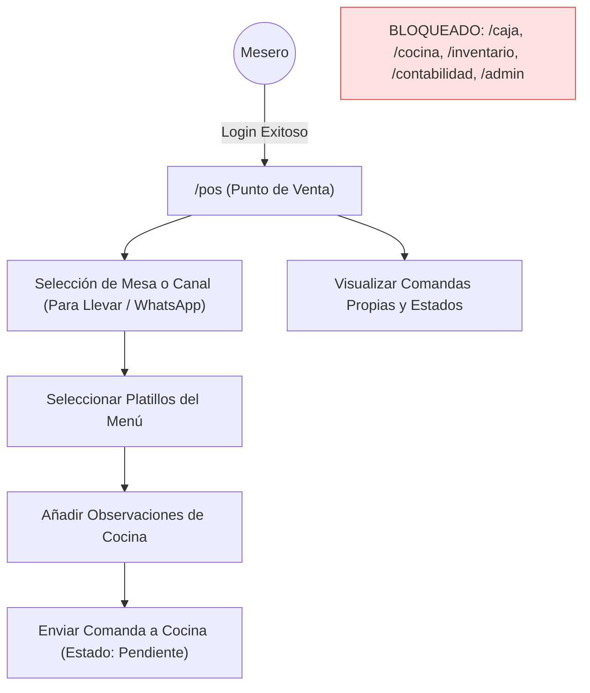
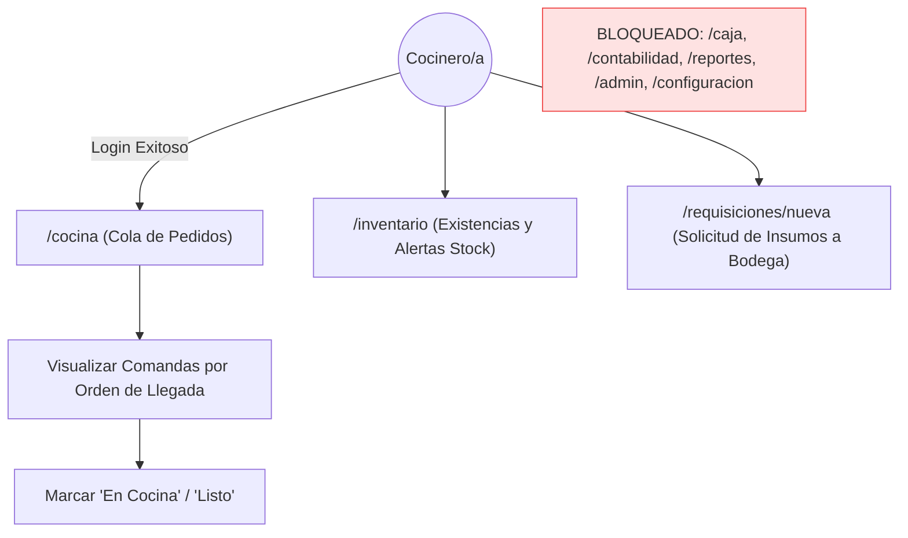
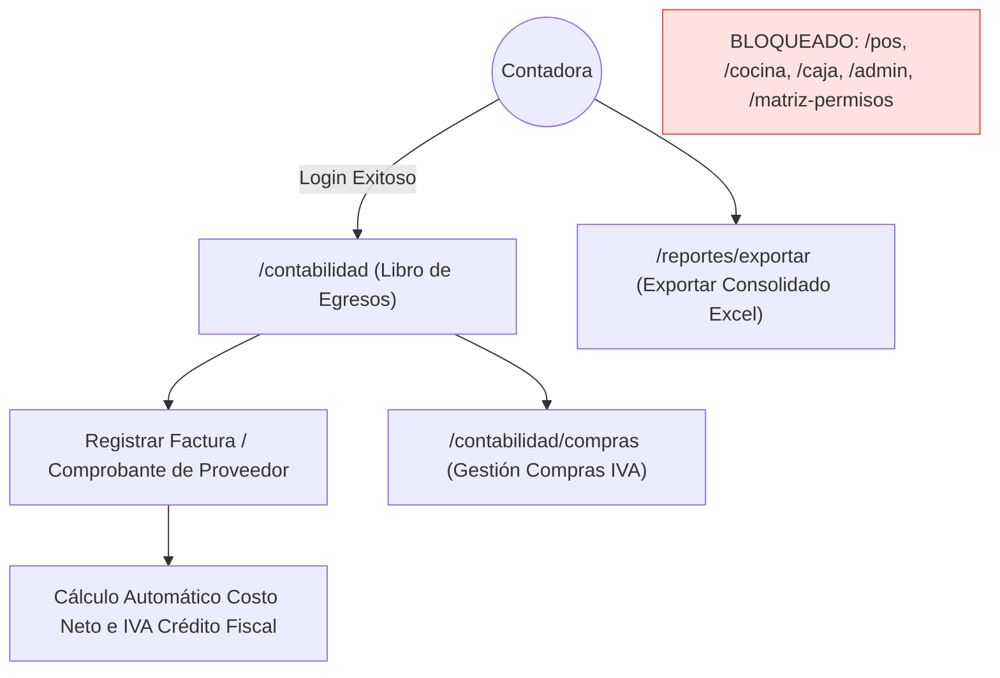

# UNIVERSIDAD DE EL SALVADOR
## FACULTAD MULTIDISCIPLINARIA ORIENTAL
### DEPARTAMENTO DE INGENIERÍA Y ARQUITECTURA
### CARRERA DE INGENIERÍA EN SISTEMAS INFORMÁTICOS
**DISEÑO DE SISTEMAS II – CICLO II-2026**

---

# TAREA CC-152: MAPA CONCEPTUAL DE NAVEGACIÓN POR ROL
### SUB-MÓDULO B5: CUADRANTE 3 – PRUEBAS DE ACEPTACIÓN
**Sistema de Gestión para el Comedor Chayito (SGCO-Chayito)**

- **Responsable:** César Josué
- **Sprint:** Sprint 2 (Completar 100 % del sistema y Plan de Pruebas v1 y v2)
- **Criterio de Aceptación:** *Cada rol tiene su mapa de navegación verificado.*

---

## 1. Introducción y Fundamento Arquitectónico

En el sistema **SGCO-Chayito**, la navegación se gestiona mediante una arquitectura de aplicación de página única (**SPA - Single Page Application**) con **Vue Router 4** y un almacén de estado reactivo (**Pinia**). La experiencia de usuario y las interfaces disponibles están estrictamente gobernadas por el principio de **Mínimo Privilegio (Principle of Least Privilege)** y control de acceso basado en roles (**RBAC** con Spatie en el backend y meta-roles en Vue Router).

La fuente de verdad de los accesos visibles se encuentra centralizada en:
- [`resources/js/shared/config/navegacion.js`](file:///c:/Users/josue/Documents/GitHub/SGCO-Chayito/resources/js/shared/config/navegacion.js) (Define los grupos e ítems de navegación lateral).
- [`resources/js/router/index.js`](file:///c:/Users/josue/Documents/GitHub/SGCO-Chayito/resources/js/router/index.js) (Define las rutas, restricciones por rol y la guarda global `router.beforeEach`).

---

## 2. Matriz Consolidada de Rutas y Accesibilidad por Rol

| Módulo / Grupo | Ruta en SPA | Nombre de Ruta | Roles Autorizados | Redirección de Inicio por Defecto |
| :--- | :--- | :--- | :--- | :---: |
| **Público** | `/login` | `login` | Todos (pública sin token) | – |
| **Operación** | `/pos` | `pos` | `mesero`, `cajero`, `administrador`, `socio` | **Mesero**, **Administrador** |
| **Operación** | `/cocina` | `cocina` | `cocinero`, `cocinera`, `administrador`, `socio` | **Cocinero**, **Cocinera** |
| **Operación** | `/caja` | `caja` | `cajero`, `administrador`, `socio` | **Cajero** |
| **Operación** | `/caja/apertura` | `caja-apertura` | `cajero`, `administrador`, `socio` | – |
| **Operación** | `/caja/ticket/:id` | `ticket-venta` | `cajero`, `administrador`, `socio` | – |
| **Operación** | `/caja/cierre` | `cierre-caja` | `cajero`, `administrador`, `socio` | – |
| **Inventario** | `/inventario` | `inventario` | `cocinero`, `cocinera`, `administrador`, `socio` | – |
| **Inventario** | `/requisiciones/nueva`| `nueva-requisicion` | `cocinero`, `cocinera`, `administrador`, `socio` | – |
| **Inventario** | `/requisiciones` | `gestion-requisiciones` | `administrador`, `socio` | – |
| **Finanzas** | `/contabilidad` | `contabilidad` | `contadora`, `administrador`, `socio` | **Contadora** |
| **Finanzas** | `/contabilidad/compras`| `compras-iva` | `contadora`, `administrador`, `socio` | – |
| **Finanzas** | `/reportes` | `reportes` | `socio`, `administrador` | **Socio** |
| **Finanzas** | `/reportes/exportar`| `exportar-reportes` | `contadora`, `socio`, `administrador` | – |
| **Configuración** | `/admin` | `admin` | `administrador`, `socio` | – |
| **Configuración** | `/matriz-permisos` | `matriz-permisos` | `administrador`, `socio` | – |
| **Configuración** | `/bitacora` | `bitacora` | `administrador`, `socio` | – |
| **Configuración** | `/configuracion` | `configuracion` | `administrador`, `socio` | – |

---

## 3. Mapa Conceptual General de Navegación del Sistema

---

## 4. Mapas Conceptuales Detallados por Rol

### 4.1. Rol: Administrador General
El Administrador dispone de navegación irrestricta a todos los módulos. Su vista de inicio por defecto es el Punto de Venta (`/pos`) o el módulo de gestión.

---

### 4.2. Rol: Socio Gerencial
El Socio accede con perfil de supervisión, auditoría y toma de decisiones. No realiza tareas operativas de sala ni puede desactivar la cuenta del administrador.

---

### 4.3. Rol: Cajero
El Cajero está enfocado en el ciclo del dinero y cobro de comandas. Redirección inicial obligatoria a `/caja`.

---

### 4.4. Rol: Mesero
El Mesero tiene acceso exclusivo al Punto de Venta para registrar y atender mesas.

---

### 4.5. Rol: Cocinero / Cocinera
El personal de cocina interactúa con la cola de preparación, consulta existencias de insumos y solicita abastecimiento. Redirección inicial a `/cocina`.

---

### 4.6. Rol: Contadora
La Contadora gestiona los egresos, el crédito fiscal de compras y la exportación de libros de IVA. Redirección inicial a `/contabilidad`.

---

## 5. Reglas de Validación de la Guarda Global (`router.beforeEach`)

El mapa de navegación no es meramente cosmético: está reforzado por una guarda de navegación programática implementada en [`resources/js/router/index.js`](file:///c:/Users/josue/Documents/GitHub/SGCO-Chayito/resources/js/router/index.js):

1. **Evaluación de Sesión:** Si la ruta requiere autenticación (`!meta.publica`) y no existe token en el store, redirige inmediatamente a `/login`.
2. **Evaluación de Meta-Roles:** Si la ruta posee un arreglo de roles autorizados (`to.meta.roles`), el enrutador verifica si el rol activo del usuario pertenece a dicho arreglo.
3. **Manejo de Intento de Acceso No Autorizado:**
   - Si un usuario con sesión activa intenta escribir en la barra de direcciones una URL prohibida (ej. un mesero navegando a `/admin` o `/caja`), la guarda intercepta la petición.
   - La guarda ejecuta `obtenerRutaInicioPorRol(sesion.rol)` y redirige automáticamente al usuario a su pantalla autorizada de inicio, evitando que visualice contenido sensible.
4. **Ciclo de Redirección Protegido:** Si un usuario no tuviese permisos ni siquiera para su ruta por defecto, la guarda destruye la sesión y lo remite a `/login` para prevenir bucles infinitos de redirección.

---

## 6. Verificación de Cumplimiento

- [x] Mapa conceptual de navegación general del sistema diagramado.
- [x] Mapa conceptual por rol documentado para los 6 roles oficiales del sistema.
- [x] Rutas de entrada por defecto verificadas contra la lógica de `obtenerRutaInicioPorRol`.
- [x] Delimitación de módulos bloqueados por principio de mínimo privilegio establecida.
- [x] Criterio de aceptación de la tarea **CC-152** plenamente cumplido y documentado para el informe final de pruebas.
